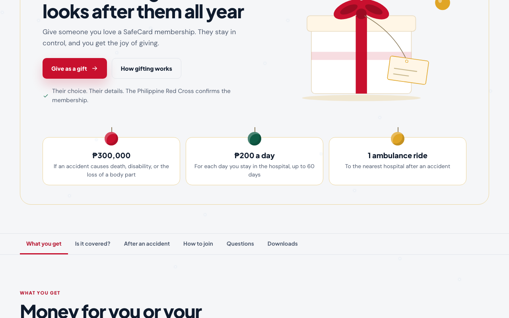
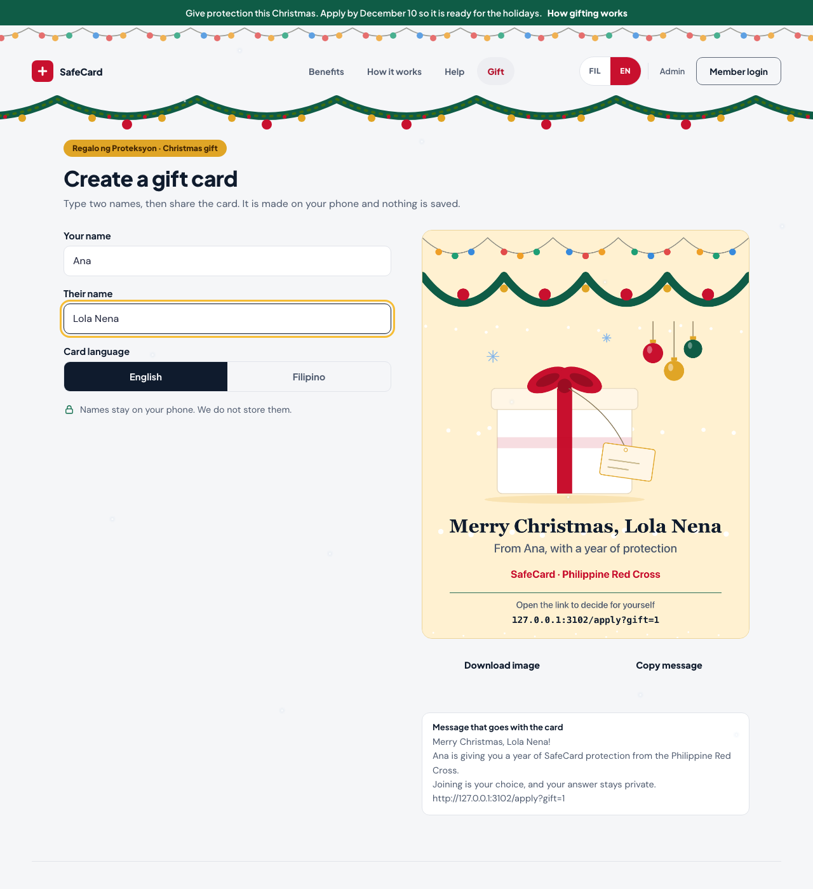

# Christmas mode (campaign `christmas-2026`)

A temporary marketing campaign: **“SafeCard is the gift of protection this Christmas.”** It adds a gift band to the home page, two gift pages, a card maker, and light decoration. **It switches itself on and off by date** and can be stopped instantly. The rest of the app is unchanged.


## What it adds (and nothing else)

| Where | What appears in season |
|---|---|
| Every public page | A green strip with the apply-by date, string lights and a garland under the header, a **Gift** link in the menu, a small footer greeting, light snowfall |
| Home page | A **gift band** under the main banner (the original banner is untouched) |
| `/gift` | How gifting works in three steps, the apply-by notice, five questions and answers |
| `/gift/card` | The card maker: type two names, see the card, **Share**, **Download image**, or **Copy message** |
| `/apply?gift=1` | A friendly welcome panel on the first step only |
| Member card | A short seasonal greeting under the card |
| Application | A quiet garland on every step **except payment**, which is never decorated |





## What it never does

- It does **not** change the application, consent, payment or review steps.
- It does **not** send or store the names typed into the card maker. The card is drawn in the visitor’s own browser. The shared link is `/apply?gift=1` and contains **no names**.
- It does **not** use cookies, local storage, or any new server route or database table.
- It does **not** pay for anyone, or apply for anyone.
- It does **not** use a QR code.
- It respects **reduced motion** (no snowfall, no twinkling) and works in light and dark mode, in English and Filipino.

## How it switches on and off

Everything seasonal is **always present in the page** but **hidden** until a tiny script in the page header sets `data-season="christmas"` on the `<html>` element. This means no flash, no stale pages, and **no deploy is needed when the dates arrive**.

| Control | Effect | Use it for |
|---|---|---|
| **The calendar** (default) | On from **15 Nov 2026 00:00** to **1 Jan 2027 00:00**, Philippine time | Normal running |
| `?season=christmas` on any page address | Shows Christmas for that visit | Previewing before launch |
| `?season=off` on any page address | Shows the normal site for that visit | Checking “normal” during the season |
| `NEXT_PUBLIC_SEASONAL_CAMPAIGN=off` | **Emergency stop for everyone**, including previews | Something is wrong; stop now |
| `NEXT_PUBLIC_SEASONAL_CAMPAIGN=always` | Forces it on at any date | Testing only. **Never set in production.** |
| *(empty or unset)* | Calendar rules apply | Normal |

Strongest wins: the setting `off` beats everything; `?season=off` beats `always`.

The dates, apply-by date and campaign id live in **one file**: [`src/lib/seasonal/christmas.ts`](../src/lib/seasonal/christmas.ts). The words (English and Filipino) live in [`src/lib/seasonal/copy.ts`](../src/lib/seasonal/copy.ts).

### Out of season

Visiting `/gift` or `/gift/card` when the campaign is off sends the visitor to the home page. Hidden markup stays hidden. Anyone who saved a gift link can still open `/apply?gift=1` and simply gets the normal application.

## Stop it right now (emergency)

1. In **Vercel → project → Settings → Environment Variables → Production**, add or set `NEXT_PUBLIC_SEASONAL_CAMPAIGN` to `off`.
2. **Redeploy** (owner’s own Vercel account, after the owner says yes). Variables beginning with `NEXT_PUBLIC_` are baked in when the site is built, so a redeploy is required.
3. Open the home page. You should see no strip, no lights and no gift band. `/gift` should send you to the home page.

To resume, delete the variable (or empty it) and redeploy.

## Remove it for good (after the holidays)

The campaign switches itself off on **1 January 2027**, but its code can stay dormant until you are ready. When you want it gone, open a normal pull request that:

1. **Deletes these folders and files**
   - `src/lib/seasonal/` (dates, wording, gift-card text, unit tests)
   - `src/components/seasonal/` (components and `christmas.css`)
   - `src/app/gift/` (the two gift pages)
   - `public/seasonal/` (the four decoration images)
   - `tests/e2e/christmas.spec.ts`
2. **Removes the few mount points.** Find them all with:
   ```bash
   grep -rn "SEASONAL:christmas-2026" src
   ```
   Each hit is one import or one line to delete: the head script and CSS import in `src/app/layout.tsx` (and `suppressHydrationWarning` on `<html>`), `SiteHeader.tsx`, `PublicFooter.tsx`, `LandingExperience.tsx`, `ApplicationWizard.tsx`, and `src/app/member/card/page.tsx`.
3. **Removes** `NEXT_PUBLIC_SEASONAL_CAMPAIGN` from `.env.example` and from Vercel.
4. **Passes the normal checks** (lint, typecheck, unit tests, build, browser tests), then ships like any other change.

Nothing in the database or storage needs cleaning up, because the campaign never created anything there.

## How it was tested

- **Unit tests** (`src/lib/seasonal/*.test.ts`): the date window; the kill switch; preview parameters; and the real boot script is run against the real gate so the two cannot drift apart; gift-card text, name cleaning and message wording.
- **Browser tests** (`tests/e2e/christmas.spec.ts`), on Chrome, Firefox, Safari and two phone sizes:
  - season off: nothing seasonal is visible, the gift pages redirect home, the welcome does not show;
  - season on: band, strip, links and the original banner all present; the gift welcome only with `?gift=1`; the payment step never decorated; reduced motion honoured;
  - card maker: the card changes with the names; angle brackets and control characters never reach the card or message; names are capped; download gives a PNG; copy puts the right message on the clipboard; Share appears only where the browser supports it, shares an image plus text, and a closed share sheet is not an error; **no request is made to a server and nothing is stored**;
  - accessibility (axe) in English and Filipino, light and dark; no sideways scrolling at 320, 375 and 768 pixels; keyboard use.
- **Regression proof:** the entire pre-existing browser suite was run twice, once with the season off and once with a build forced on (`NEXT_PUBLIC_SEASONAL_CAMPAIGN=always`), to prove existing features behave the same in and out of season.

## Decisions to know about

- **No QR code.** The earlier design showed one; the project removed its QR dependency, and a link is simpler and just as shareable.
- **No giver name in the link or the member card.** Carrying a name would mean storing or transmitting personal data. The member greeting is generic.
- **The gift band is added under the hero, not instead of it,** so the real hero, its tests and its wording are untouched.
