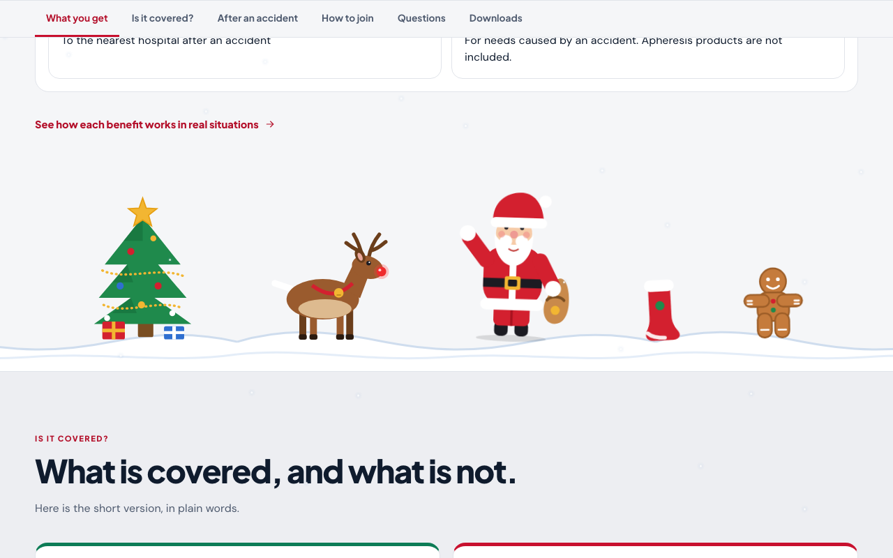

# Christmas mode (campaign `christmas-2026`)

A festive look for the whole public site: **“Merry Christmas from SafeCard.”** It adds Santa Claus, his reindeer, a snowman, a tree and other Christmas characters, string lights, a garland, snowfall and a green banner with the apply-by date. **It is always on.** It has no date window and no switch. There is no gifting feature. The rest of the app is unchanged.

## What it adds (and nothing else)

| Where | What appears |
|---|---|
| Every public page | A green strip with the apply-by date and swinging bells, string lights and a garland under the header, a Santa hat on the SafeCard logo, light snowfall, and at the foot a snowy scene (tree, Santa, reindeer) with a greeting |
| Home page | A **Christmas band** under the main banner: a night scene with Santa’s sleigh and reindeer, plus three benefit amounts hung like ornaments. Between the sections, four snowy scenes with Santa, a reindeer, a snowman, a gingerbread man, candy canes, a stocking, bells and holly, and a sleigh that flies across |
| Application | A quiet garland and a small scene on every step **except payment**, which is never decorated |
| Member card | A short seasonal greeting under the card |




## What it never does

- It does **not** change the application, consent, payment or review steps.
- It does **not** collect, send or store anything. It adds no cookies, local storage, server route or database table.
- It does **not** cover text or catch a click: the pictures take their own space, ignore the pointer and are hidden from screen readers.
- It respects **reduced motion** (no snowfall, swinging, waving or flying) and works in light and dark mode, in English and Filipino.
- It is hidden when a page is printed.

## It is always on

There is no calendar, no setting and no web-address trick that turns it on or off. Every visitor sees it, on every deploy. The apply-by date and the campaign id live in one file: [`src/lib/seasonal/christmas.ts`](../src/lib/seasonal/christmas.ts). The words (English and Filipino) live in [`src/lib/seasonal/copy.ts`](../src/lib/seasonal/copy.ts). The pictures are plain SVG files in [`public/seasonal/`](../public/seasonal/).

Going back to the original look is a **separate request**. The steps below describe what that change would involve, so it can be done safely when it is asked for.

## Taking it down (only on a separate request)

Open a normal pull request that:

1. **Deletes these folders and files**
   - `src/lib/seasonal/` (constants, wording, unit tests)
   - `src/components/seasonal/` (components and `christmas.css`)
   - `public/seasonal/` (the decoration images)
   - `tests/e2e/christmas.spec.ts`
2. **Removes the few mount points.** Find them all with:
   ```bash
   grep -rn "SEASONAL:christmas-2026" src
   ```
   Each hit is one import or one line to delete: the CSS import in `src/app/layout.tsx`, `SiteHeader.tsx`, `PublicFooter.tsx`, `LandingExperience.tsx`, `ApplicationWizard.tsx`, and `src/app/member/card/page.tsx`.
3. **Passes the normal checks** (lint, typecheck, unit tests, build, browser tests), then ships like any other change.

Nothing in the database or storage needs cleaning up, because the campaign never created anything there.

## How it was tested

- **Unit tests** (`src/lib/seasonal/copy.test.ts`): every line exists in both languages, the apply-by date is in the strip, band and footer, and no wording mentions gifting.
- **Browser tests** (`tests/e2e/christmas.spec.ts`), on Chrome, Firefox, Safari and two phone sizes:
  - the page: strip, band, scenes (Santa, reindeer, snowman, tree, gingerbread), flying sleigh and the original banner all present; every picture loads; the payment step never decorated;
  - decoration is hidden from screen readers and never takes a click;
  - snow, swinging, waving and the flying sleigh stay still for reduced motion;
  - the Filipino site is festive too;
  - gifting is gone: `/gift` and `/gift/card` return 404 and no page offers a gift link, button or welcome;
  - accessibility (axe) in English and Filipino, light and dark; no sideways scrolling at 320, 375, 768 and 1440 pixels.
- **Regression proof:** the entire pre-existing browser suite was run with the campaign on, to prove existing features behave the same.

## Decisions to know about

- **No gifting.** An earlier version had gift pages and a card maker. They were removed completely, and old gift links open the normal application.
- **The Christmas band is added under the hero, not instead of it,** so the real hero, its tests and its wording are untouched.
- **The payment step is never decorated,** so nobody is distracted while paying.
