# User manual 1: applicants and members

*This is what the public sees. Read it to understand the product, or to help a relative apply.*

**In this manual:** [What SafeCard is](#1-what-safecard-is) · [The home page](#2-the-home-page) · [Applying, step by step](#3-applying-step-by-step) · [After you apply](#4-after-you-apply-the-member-area) · [Your SafeCard](#5-your-safecard) · [Language, phones and privacy](#6-language-phones-and-privacy) · [The Christmas look](#7-the-christmas-look) · [When something goes wrong](#8-when-something-goes-wrong)

---

## 1. What SafeCard is

**Safe Card** is a one-year membership from the **Philippine Red Cross (PRC)**. It costs **₱1,200**, covers ages **3 to 85**, and helps when there is an accident. Two different groups give two different kinds of help:

| Who | What they give | Think of it as |
|---|---|---|
| **The insurance company** (Prudential Guarantee and Assurance Inc., “PGAI”) | Money after an approved claim, for example ₱300,000 for accidental death or disability, and ₱200 a day for hospital stays (up to 60 days) | A safety net of cash |
| **The Philippine Red Cross** | Services, when available: one ambulance ride and one unit of whole blood for an accident | Hands-on help |

> **Important.** The PRC is *not* the insurer, and the Red Cross services depend on availability. The website never promises a guaranteed amount or a guaranteed ambulance. The insurance policy decides what is paid.

**This website** (SafeCard) does four jobs:

1. **Explains** Safe Card in plain Filipino and English.
2. **Takes applications** with privacy and consent built in.
3. **Takes proof of payment** (a photo or PDF of your receipt).
4. **Shows your status and your digital card** once an administrator approves you.

Here is the whole journey in one picture:

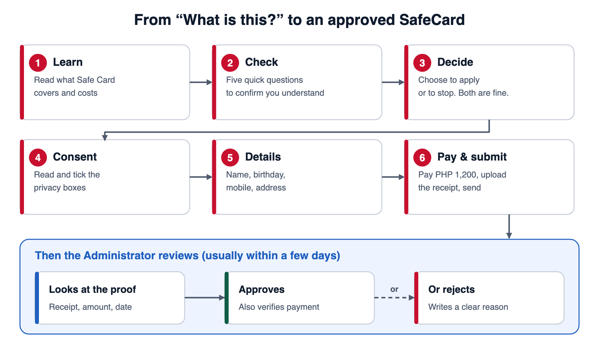

---

## 2. The home page

Open the website. The first screen tells you the three things people ask first: **the price (₱1,200 a year)**, **the main protection (up to ₱300,000)**, and **who it is for (ages 3 to 85)**.

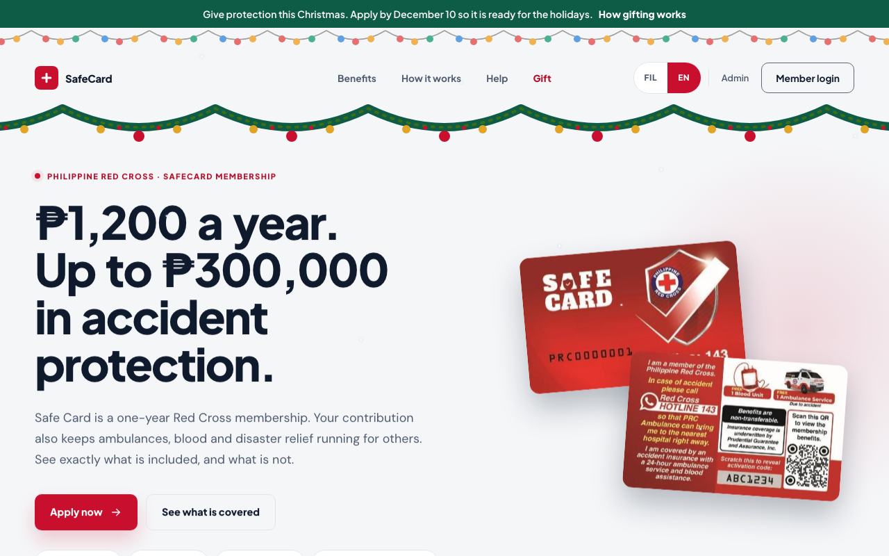

**On a phone** the same page rearranges into one column. The menu hides behind the three-line button at the top right.

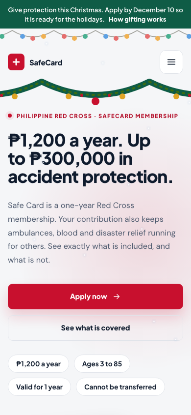

### Finding your way around

| Where | What it is |
|---|---|
| **Benefits** | What you get, shown with real-life examples. |
| **How it works** | The steps to join. |
| **Help** | Who to call, and answers to common questions. |
| **Member login** | For people who already applied. |
| **Admin** | For staff only. Applicants never need it. |
| **FIL / EN** | Switches the language between Filipino and English. |

Scroll down the home page and you will find, in order: *What you get*, *Is it covered?*, *After an accident*, *How to join*, *Questions*, and *Downloads* (the official guides as PDFs).

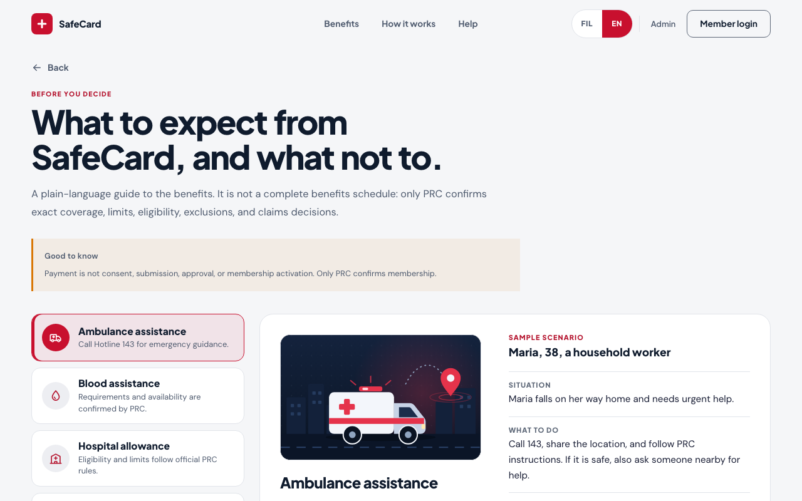

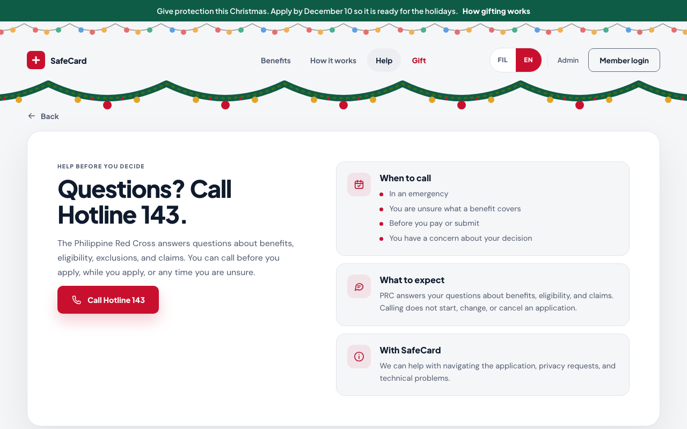

**Emergency?** The footer always shows **Hotline 143**. Call it first; the website is not an emergency service.

---

## 3. Applying, step by step

Press **Apply**. You will see a short progress bar at the top. Nothing is saved on our side until the **last** button. If you stop halfway, nothing is kept.

### Step 1: Learn

A short page that repeats the key facts: the price, what is covered, and that joining is voluntary.

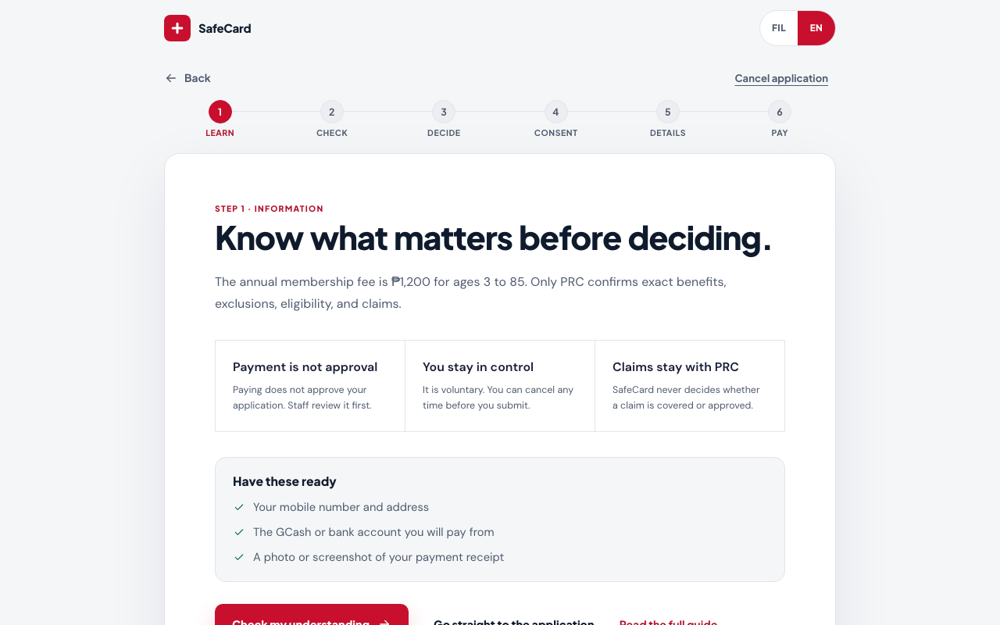

### Step 2: Check your understanding

Five short questions, one at a time. They are not a test you can fail forever; they are there so nobody pays for something they misunderstood. You can read the answers again and retry.

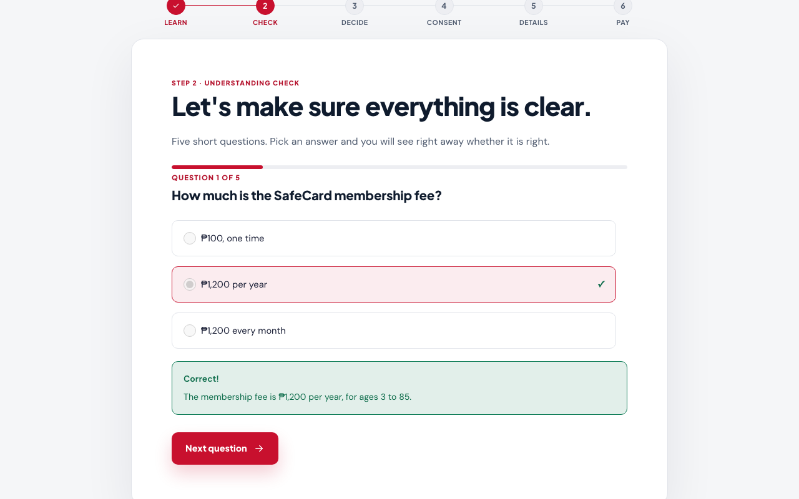

### Step 3: Decide

You choose **Apply** or **I do not want to apply**. Both are fine. If you decline, you are thanked and nothing is stored.

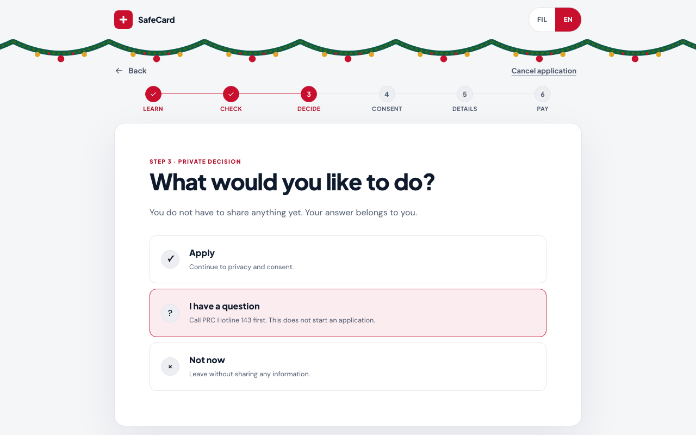

### Step 4: Consent

You read the privacy notice and tick the boxes to say you agree to what happens with your information. **You cannot reach the details form without this step.** That is a deliberate rule, not a bug.

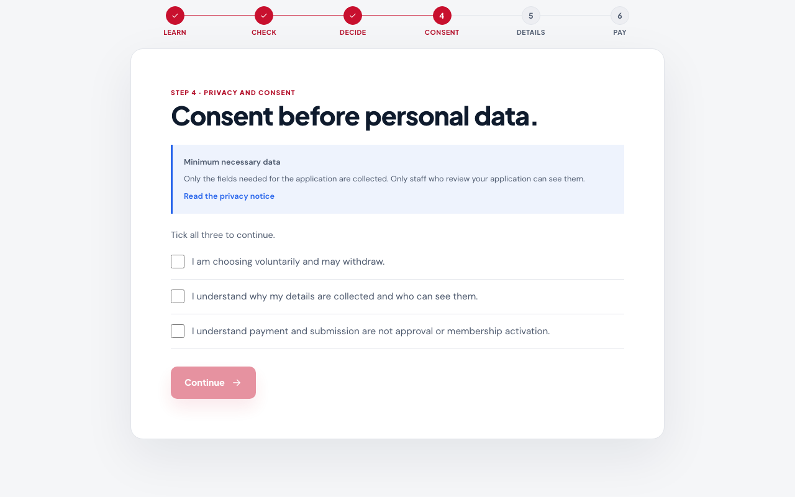

### Step 5: Your details

First name, last name, date of birth, sex, mobile number, address, city, province and zip code. The form tells you which fields are required and which are optional, and it tells you what is wrong right next to the field.

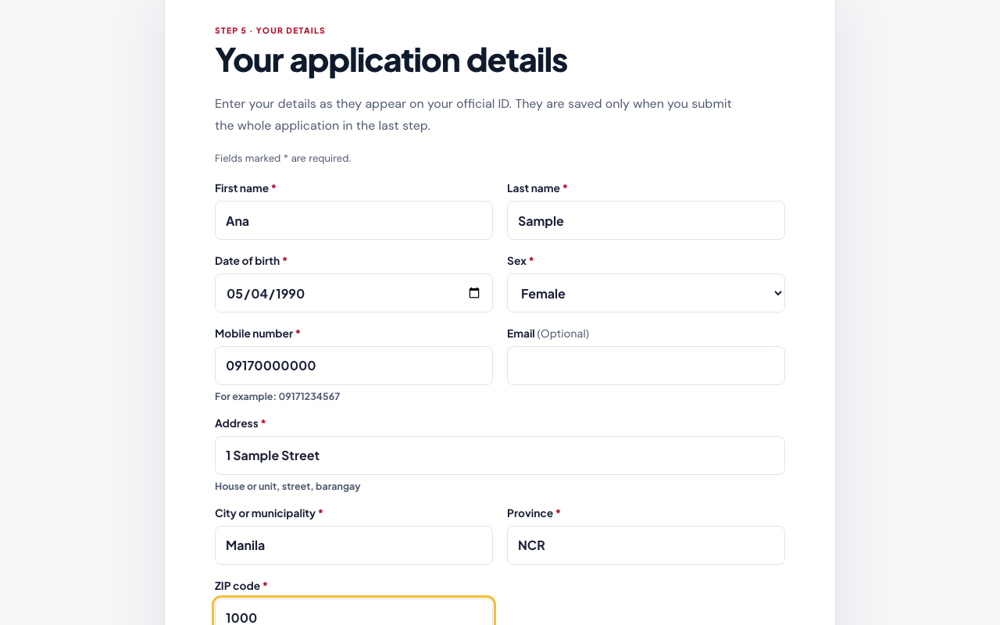

> **Tip:** use the mobile number you will keep. It is how you sign in to the member area later.

### Step 6: Pay and submit

1. Pick **how you will pay** (the page shows the official payment details, such as a bank account or a QR code).
2. **Pay ₱1,200** using your own banking or e-wallet app. *The website does not take the money itself.*
3. **Upload your receipt**: a photo (JPEG, PNG, WebP) or a PDF, up to 10 MB. Make sure the amount, date and reference number are readable.
4. Tick the box that says you made this payment.
5. Press **Submit application**.

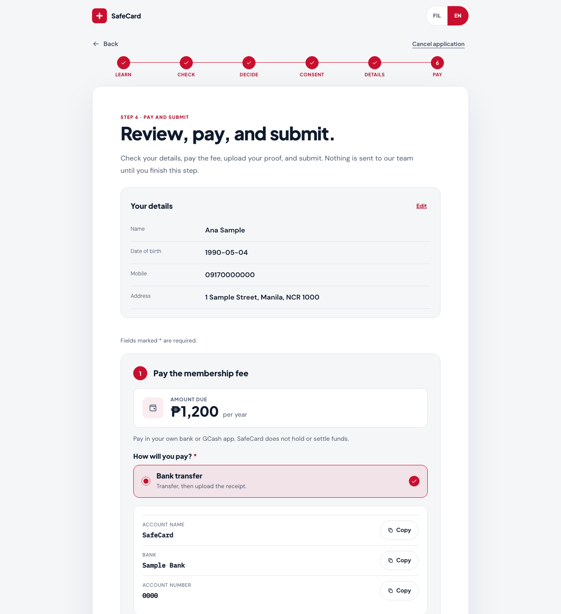

When it works you see **“We have received your application”** and an **application reference** that looks like `SC-2026-XXXXXXXX`. **Write it down or take a screenshot.** You need it to sign in later.

> **Not approved yet.** Submitting is *not* approval. An administrator must still check your application and your receipt.

---

## 4. After you apply: the member area

Press **Member login**. You sign in with two things you already know:

- your **application reference** (the `SC-…` code), and
- the **mobile number** you registered.

There is **no text-message code**. After a successful sign-in you stay signed in for **30 minutes**, then the site signs you out. Always press **Sign out** on a shared phone or computer.

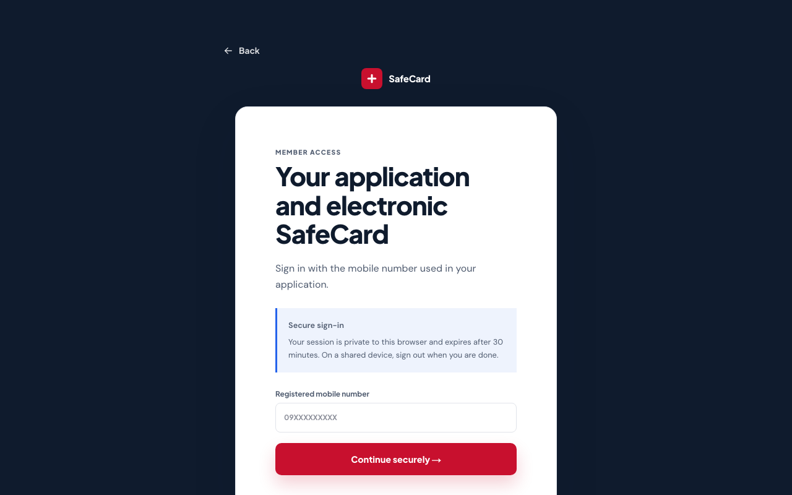

### Status page

The status page shows your progress in plain words and tells you **what to do next**.

**While you wait:**

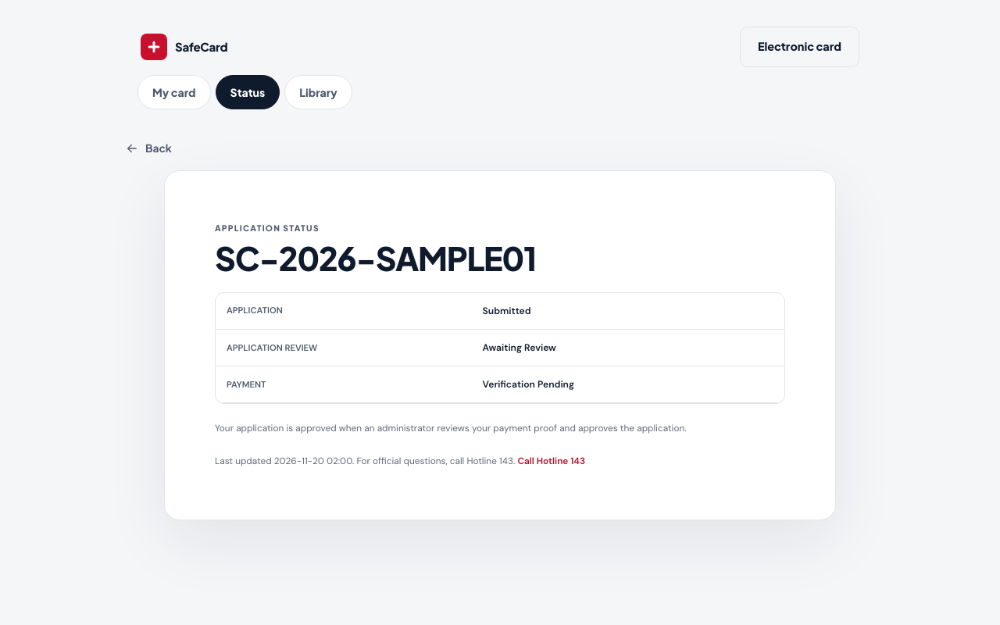

**After approval:**

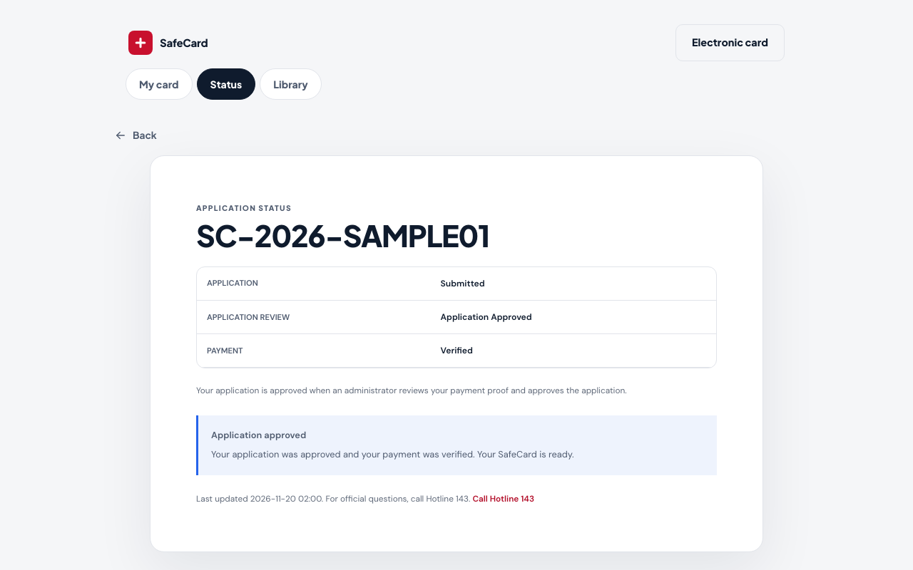

| You see | It means | You should |
|---|---|---|
| *Pending / waiting for review* | An administrator has not looked yet. | Wait. Check your status page again later. |
| *Approved* | Application and payment proof accepted. | Open your card. |
| *Rejected* (with a reason) | Something was wrong, such as a mismatched amount. | Read the reason; contact the Help number if unsure. |
| *Correction needed* | A detail needs fixing. | Use the correction page the site offers. |

---

## 5. Your SafeCard

Once approved, **View card** shows your **electronic SafeCard**: your name, a masked mobile number (only the first and last digits show), your location, the date approved, and your reference.

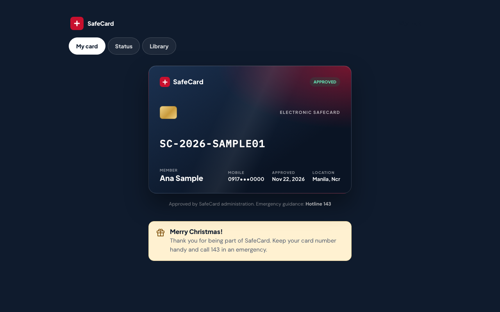

The card is a **digital copy for showing and checking**. In an emergency call **Hotline 143** and give your Safe Card number. Benefits depend on eligibility and the official PRC and insurance rules; the card is not a guarantee of any amount.

The **Library** in the member area holds the official Safe Card guides and FAQs.

---

## 6. Language, phones and privacy

- **Language.** The site opens in **Filipino** the first time. Press **EN** at the top to read English. It remembers your choice on your device.
- **Phones.** Everything works on a small phone screen. Text stays readable and nothing needs sideways scrolling.
- **Dark mode.** If your phone is set to dark mode, the site follows it.
- **Privacy.** Your details are visible only to the administrators who review applications, and every time they open them it is recorded. Your receipt is stored privately and is never shown on a public address.
- **Shared devices.** When you finish, press **Sign out**. If you cancel an application, the site clears what it held.

---

## 7. The Christmas look

The site wears a Christmas look. The home page has a **Christmas band** under the main banner, string lights, a garland and a Santa hat on the logo. Between the sections you will meet Santa Claus, his reindeer, a snowman, a gingerbread man, a tree and a sleigh that flies across the page.

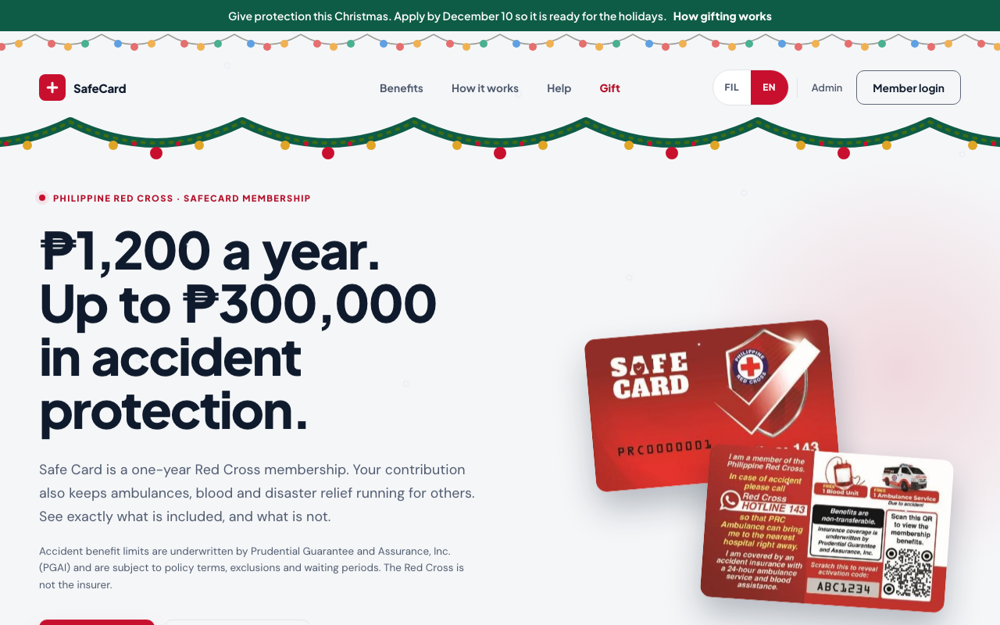

- It is **only decoration**. The application, consent, payment and review steps work exactly as described above, and the payment step is never decorated.
- It does not collect or store anything.
- If you are sensitive to motion, set your device to “reduce motion” and the snow, swinging and flying stop.

On a phone it looks like this:

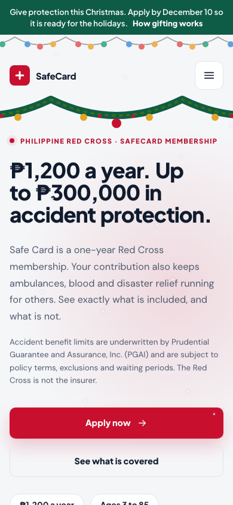

---

## 8. When something goes wrong

| What you see | Try this |
|---|---|
| The page will not load | Check your internet. Reload. Try again in a few minutes. |
| “Service unavailable” on Apply | The site is in practice mode or paused. Check Help for the official way to join. |
| Upload says the file is not allowed | Use a JPEG, PNG, WebP or PDF, 10 MB or smaller. Take the photo again with the whole receipt in view. |
| Cannot sign in to the member area | Check the reference (starts with `SC-`) and use the **same mobile number** you applied with. You are signed out after 30 minutes. |
| You forgot your reference | Contact the Help number; do not make a second application. |
| You want your information removed | Use the privacy request option in **Help** or **Privacy**. |
| It looks broken on your phone | Send a screenshot and your phone model to the contact on the **Help** page. |

**Who to contact** (from the official Safe Card guide): members@redcross.org.ph · claims: maabclaims@redcross.org.ph · (+63 2) 8790-2300 loc 184 · emergencies: **Hotline 143**.
