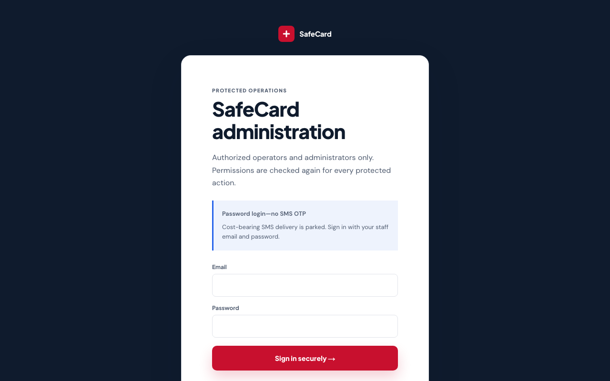
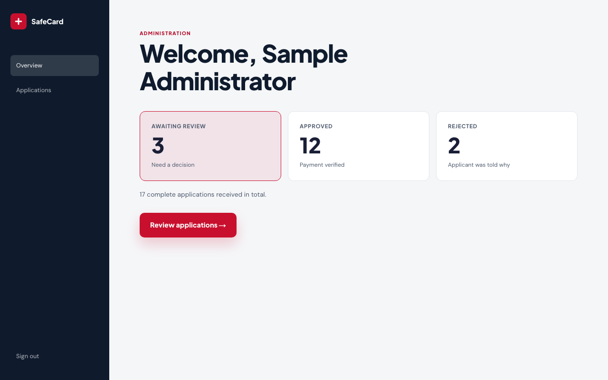
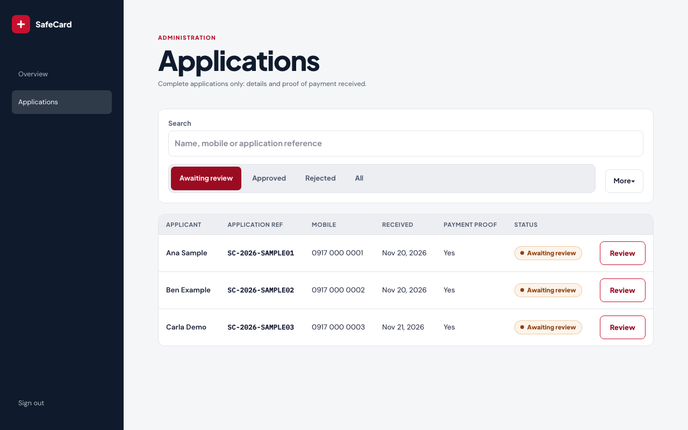
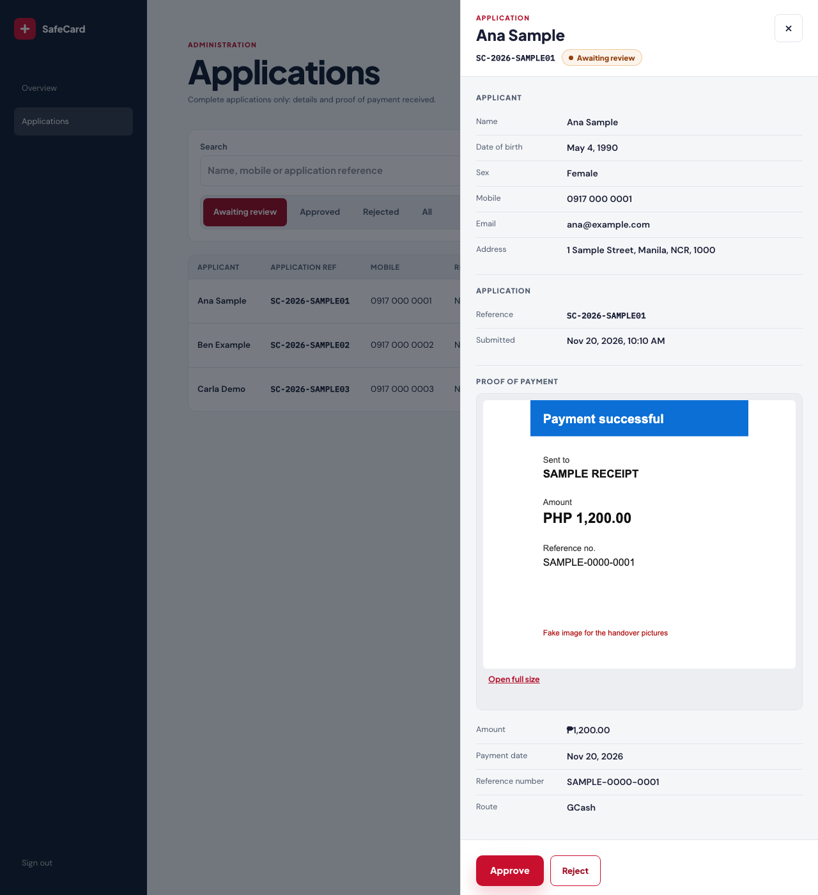
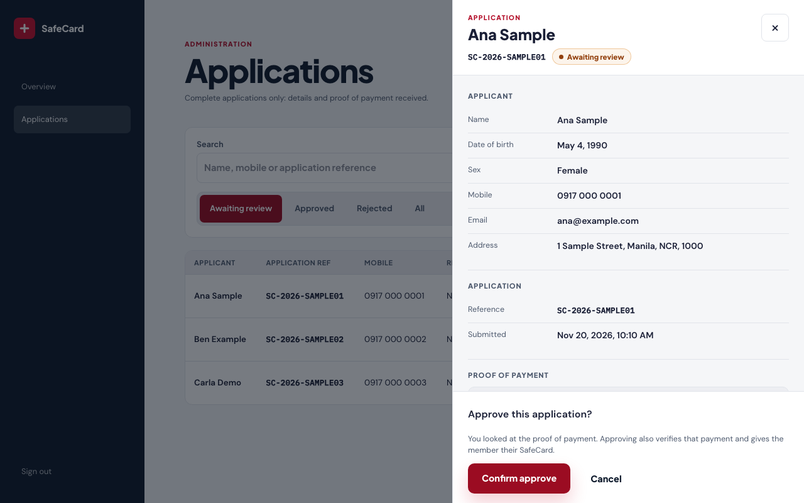
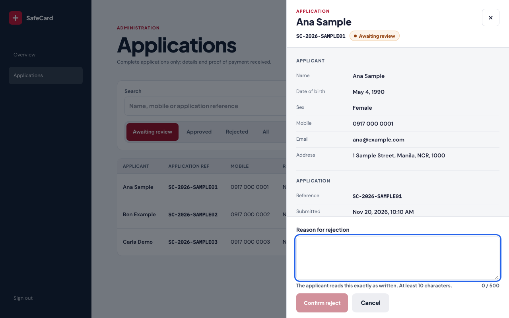
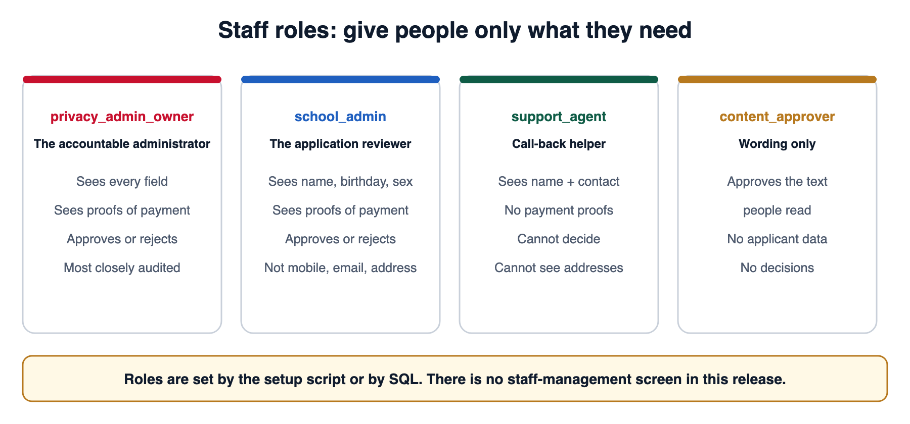

# User manual 2: administrators

*For the people who review applications. No technical knowledge needed.*

**In this manual:** [Your job in one sentence](#1-your-job-in-one-sentence) · [Signing in](#2-signing-in) · [The overview](#3-the-overview-screen) · [The applications list](#4-the-applications-list) · [Reviewing one application](#5-reviewing-one-application) · [Approving](#6-approving) · [Rejecting](#7-rejecting) · [Rules for handling private data](#8-rules-for-handling-private-data) · [Roles](#9-roles-who-can-do-what) · [Tricky situations](#10-tricky-situations) · [Your checklist](#11-your-checklist)

> **Practice first.** The pictures in this manual use **sample people** (Ana Sample, Ben Example, Carla Demo) and a **fake receipt**. Learn the screens on practice data before you touch a real applicant.

---

## 1. Your job in one sentence

> **Look at each complete application and its proof of payment, then either approve it or reject it with a clear reason.**

Nothing else is expected of you. There is no separate “verify payment” screen, no export to the Red Cross, and no analytics dashboard in this release. **Approving also confirms the payment**, so look at the receipt carefully before you press the button.

“Complete” means the person has *submitted their details* **and** *uploaded a proof of payment*. People who are still filling in the form never appear in your list.

---

## 2. Signing in

1. Go to the website address you were given and add `/admin/login` (or press **Admin** at the top of any page).
2. Type your **staff email** and **password**, then press **Sign in securely**.

Rules for passwords:

- Your account is **yours alone**. Never share it and never write the password in a chat.
- There is **no text-message code**. Your email and password are the whole login.
- If you are given a temporary password, ask the owner how to replace it with a private one **before** you start work, and never reuse a password from another site.
- If you cannot sign in, ask the owner to check your account. Do not keep trying again and again.

Every sign-in and sign-out is recorded in a log that nobody can edit afterwards.

> **When you are done, press Sign out** (bottom of the dark menu on the left), especially on a shared computer.

---

## 3. The overview screen

After signing in you land on the **overview**. It has three numbers and one big way in.

| Number | Meaning |
|---|---|
| **Awaiting review** | Complete applications nobody has decided yet. **This is your to-do list.** |
| **Approved** | Applications approved so far. |
| **Rejected** | Applications rejected so far. |

If more than one campaign exists, a **Campaign** drop-down appears. Make sure the right campaign is selected (for this pilot: **Safe Card Pilot 2026**).

Press the link into the list to start working.

---

## 4. The applications list

**Columns:** Applicant · Application ref · Mobile · Received · Payment proof · Status · **Review** button.

**Finding someone**

- **Search box:** type a *name*, a *mobile number* or an *application reference* (at least 2 characters). The list updates after you stop typing.
- **Status control:** *Awaiting review* (default), *Approved*, *Rejected*, or *All*.
- **More:** choose a *received-date range* or *Oldest first*.

Your search and filters are stored in the web address, so you can bookmark a view or send the link to a teammate (it contains no personal details).

> **Tip:** work from **Oldest first** so nobody waits longer than anybody else.

---

## 5. Reviewing one application

Press **Review** on a row. A panel slides in from the right. Take your time here: this is the whole job.

**On the left, the person:** name, date of birth, sex, mobile, email, address, application reference, and when they submitted.

**On the right, the proof of payment:** the uploaded receipt image or PDF, plus what the applicant *told us*: **amount**, **payment date**, **reference number** and **payment route** (GCash, bank transfer, or paid at a Red Cross chapter).

### The five-point check

Tick these in your head every time:

1. **Amount.** Does the receipt show exactly **₱1,200**?
2. **Date.** Does the receipt date match the “payment date” the applicant typed?
3. **Reference number.** Does it match what the applicant typed?
4. **Right place.** Was the money sent to the official SafeCard payment details, not someone else’s?
5. **Readable and real.** Can you clearly read it? Does it look like a genuine receipt, not edited or cropped to hide details?

If all five are yes, approve. If any are no, reject with a reason, or ask the owner when unsure.

**Your screen may show less than the pictures.** The pictures use the fullest view. The system only sends your role the fields it needs: for example, a `school_admin` sees the applicant’s name, birthday and sex and the proof of payment, but **not** the mobile number, email or address. A field your role may not read is neither shown nor searchable. That is on purpose.

---

## 6. Approving

1. In the panel press **Approve**.
2. The panel asks you to **confirm**. Read it, then confirm.
3. The row changes to **Approved**. The applicant’s status page updates, and their **electronic SafeCard** becomes available to them.

Approving **also marks the payment proof as verified** in the same action. That is by design, so you are confirming both the person and the money.

**You cannot undo an approval from the screen.** If you approved by mistake, **do not try to fix it yourself**. Tell the owner immediately with the application reference.

---

## 7. Rejecting

1. Press **Reject**.
2. Type a **reason**: **10 to 500 characters**. The applicant will **read this**, so write kindly and clearly.
3. Confirm.

**Good reasons** (specific, polite, tell them what happened):

- “The receipt shows ₱1,000, but the membership fee is ₱1,200.”
- “The receipt image is too blurry to read the amount. Please contact the Help number so we can arrange a clearer copy.”
- “The payment was sent to a different account than the official SafeCard details.”

**Bad reasons** (vague, rude, or sharing private details):

- “Fake.”
- “Not accepted.”
- Anything that includes someone else’s personal information.

The reason is stored with the decision and shown on the applicant’s status page and in your panel afterwards.

If an application is **no longer awaiting review** (a teammate decided first), the screen refuses a second decision. That is the system protecting you from double decisions.

---

## 8. Rules for handling private data

You are looking at real people’s names, birthdays, addresses and money records. Follow these without exception:

| Do | Do not |
|---|---|
| Work only inside the admin screens | Screenshot, photograph or download applicant details or receipts |
| Close the review panel when you step away | Send an applicant’s details by chat, email or social media |
| Sign out on shared computers | Keep the page open on a shared screen |
| Use search to find a person you need | Browse people out of curiosity (every view is recorded) |
| Report a mistake straight away | Hide a mistake. Mistakes are fixable; hidden ones are not |

Every time you open an application, the system records **who** opened it and **which fields** they saw. This protects applicants **and** protects you.

---

## 9. Roles: who can do what

Staff accounts have a **role** that decides what they can do.

| Role | Plain meaning |
|---|---|
| `privacy_admin_owner` | The accountable administrator for the pilot. The only role that sees every field. Most closely audited. |
| `school_admin` | The application reviewer. Sees name, birthday, sex and the proof of payment; approves or rejects. Does **not** see mobile, email or address. |
| `support_agent` | Call-back helper. Sees name and contact details only. No payment proofs and no decisions. |
| `content_approver` | Approves the wording people read. No applicant data and no decisions. |

If someone holds more than one role they get the combined access of all of them.

There is **no screen to add or remove staff** in this release. Accounts and roles are created by the owner using the setup tools. If you need access changed, ask the owner.

---

## 10. Tricky situations

*These are suggested ways to handle them. If the owner sets a different rule, the owner’s rule wins.*

| Situation | What to do |
|---|---|
| Receipt amount is wrong (too high or too low) | Reject with the exact amounts in the reason. |
| Receipt is a PDF and will not open | Try again once. If it still fails, tell the owner; do **not** decide without seeing it. |
| Two applications from the same person | Approve the complete, correct one; reject the duplicate with “Duplicate of application SC-…”. Ask the owner if unsure which is correct. |
| An applicant calls and asks you to “hurry” | Be kind, give no private details over the phone, and follow the normal order. |
| Someone says they paid someone else on the applicant’s behalf | That is fine if the receipt is correct. The applicant still must be the person who consented. |
| You think a receipt is edited | Do not approve. Reject (or hold) and tell the owner. |
| The page shows an error or looks wrong | Reload once. If it persists, take a screenshot **without any private details visible** and tell the owner. Also see the [Stop button](04-hypercare-and-runbooks.md#2-the-stop-button). |
| The date of birth is outside ages 3 to 85 | The program covers ages 3 to 85. Do not approve; ask the owner. |

---

## 11. Your checklist

Print this or keep it handy, and use it every time you work.

- [ ] Sign in. Check you are on the right **campaign**.
- [ ] Open **Awaiting review** and set **Oldest first**.
- [ ] Review each application with the **five-point check**.
- [ ] Approve or reject (with a clear reason). Never leave a half-finished decision.
- [ ] Anything odd? Write it in the **hypercare log** ([see document 4](04-hypercare-and-runbooks.md#4-the-hypercare-log)).
- [ ] Close the panel. **Sign out.**
