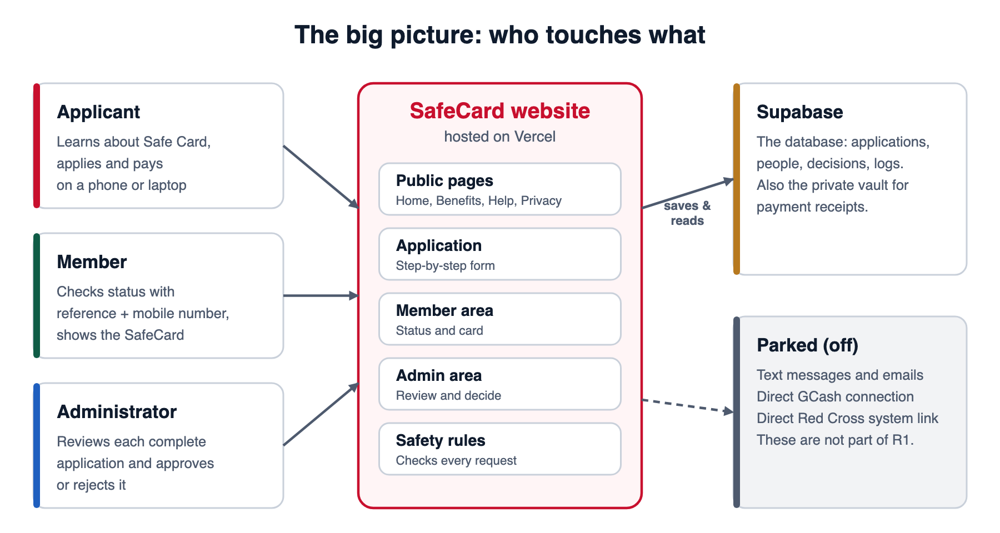
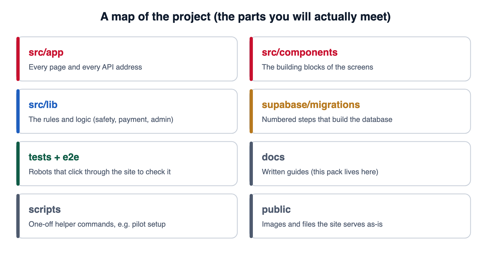
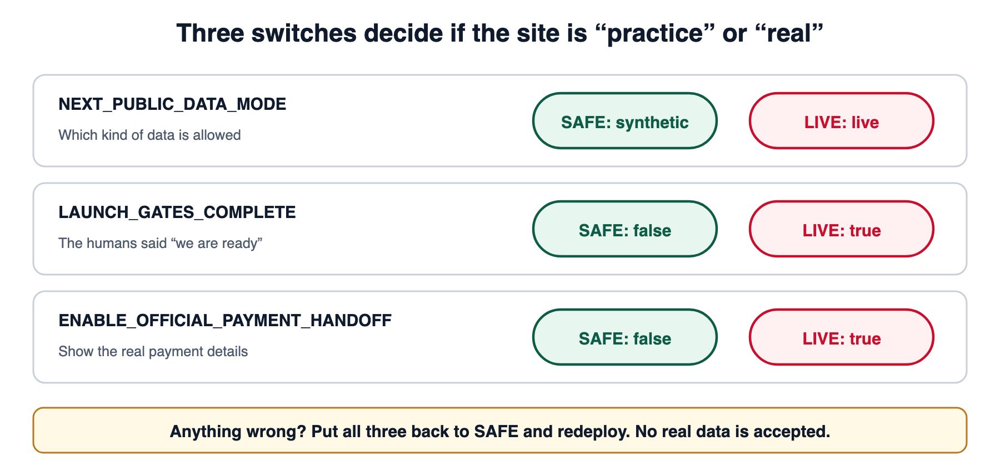
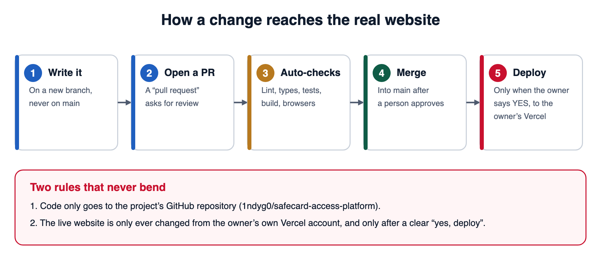
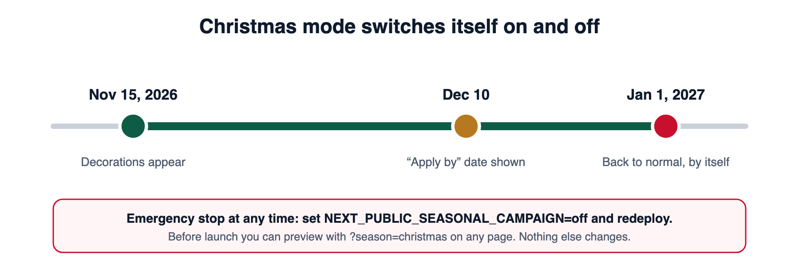

# Technical handover

*How SafeCard is built, how to run it, how to change it safely, and how to look after it.*

**Reading level:** no coding experience assumed. Words in *italics* are explained in the [glossary](05-glossary-and-faq.md). Code boxes are things you type into the **Terminal** (a text window where you give your computer commands). If a box starts with a `#`, that line is a comment for you, not a command.

**In this document:**
[1. What you are looking after](#1-what-you-are-looking-after) · [2. Run it on your computer](#2-run-it-on-your-computer) · [3. Folder map](#3-folder-map) · [4. How a request travels](#4-how-a-request-travels) · [5. Settings and safety switches](#5-settings-and-the-safety-switches) · [6. The database (Supabase)](#6-the-database-supabase) · [7. Payments and receipts](#7-payments-and-receipts) · [8. Security model](#8-security-model) · [9. Tests and automatic checks](#9-tests-and-automatic-checks) · [10. Changing and releasing](#10-changing-and-releasing-code-the-lifecycle) · [11. Security housekeeping](#11-security-housekeeping) · [12. Christmas mode](#12-christmas-mode) · [13. Retaking the pictures](#13-retaking-the-pictures) · [14. Open decisions](#14-open-decisions-and-known-gaps) · [15. Cheat sheet](#15-cheat-sheet)

---

## 1. What you are looking after

SafeCard is **one website** that has a public side, a member side and an admin side. It is built from these ingredients:

| Ingredient | What it is, in plain words | Where to see it |
|---|---|---|
| **Next.js 16** | The framework (a ready-made toolbox) that builds pages and the little server programs behind them. **This version has breaking changes compared with older Next.js.** Always read the guides inside `node_modules/next/dist/docs/` before changing how pages work, and read `AGENTS.md` at the top of the project. | `src/app` |
| **React 19** | The library that draws what you see on screen. | `src/components` |
| **TypeScript** | JavaScript with labels that catch mistakes before the site runs. | every `.ts` / `.tsx` file |
| **Supabase** | Our database (a very organised spreadsheet), login system, and private file storage for receipts. | `supabase/` |
| **Vercel** | The company that hosts (runs) the website on the internet. | owner’s own account |
| **GitHub** | Where the code and its history live; where changes are reviewed. | `1ndyg0/safecard-access-platform` |
| **Zod** | Checks that data coming in looks right before we trust it. | `src/lib/validation` |
| **Vitest** | Quick tests of small pieces of logic. | `*.test.ts` files |
| **Playwright** | Robot browsers (Chrome, Firefox, Safari) that click through the whole site to check it. | `tests/e2e`, `e2e` |



**The shape of the app:**

- **Public pages** (`/`, `/benefits`, `/help`, `/privacy`): information. No sign-in.
- **Application** (`/apply`): a one-page, step-by-step flow with privacy consent before details.
- **Member area** (`/member`, `/member/status`, `/member/card`, `/member/library`): sign in with application reference + mobile number.
- **Admin area** (`/admin/login`, `/admin`, `/admin/applications`): staff sign-in with email and password.
- **API** (`/api/...`): the hidden server programs the screens talk to.
- **Christmas mode** (`/gift`, `/gift/card`): a temporary campaign. See [section 12](#12-christmas-mode).

**What is deliberately *not* here (“parked”):** text messages, emails, push notifications, direct GCash connection, and direct connection to the Philippine Red Cross systems. Do not switch these on without a separate reviewed decision.

---

## 2. Run it on your computer

### What you need

- A Mac or PC with **Node.js 24 or newer** (the project’s README asks for 24+; the automated checks use 22). Check with `node --version`.
- **Git**, to download the code.
- For the *full* setup only: the **Supabase CLI** and a **Docker-compatible app** (Docker Desktop or similar).

### Option A: “Quick look” (practice mode, no database, 10 minutes)

This is enough to see every public page and the apply screens.

```bash
# 1. Download the code (once)
git clone https://github.com/1ndyg0/safecard-access-platform.git
cd safecard-access-platform

# 2. Install the ingredients (once, and again whenever package.json changes)
npm install

# 3. Make your private settings file from the template
cp .env.example .env.local

# 4. Start the site
npm run dev
```

Open <http://localhost:3000>. You will see the site in **practice mode** (the template ships with `NEXT_PUBLIC_DATA_MODE=synthetic`). Press `Ctrl + C` in the Terminal to stop it.

> **Never** type real keys into `.env.example`. That file is committed to GitHub for everyone to see. Real values go only in `.env.local` (which is ignored by Git) or in Vercel’s settings.

### Option B: “Full” (with a local practice database)

Needed for admin screens and anything that saves data.

```bash
npx supabase start       # starts a practice database inside Docker
npx supabase db reset    # builds all tables from supabase/migrations and loads fake sample data
npm run dev
```

The checked-in sample data is **fake** and its test logins must never be used anywhere real. **Never run `supabase/seed.sql` against the live project.**

### Option C: run it like the real thing (production build)

The automated tests use this mode because it behaves like the live site.

```bash
npm run build
npm run start -- --port 3102
```

---

## 3. Folder map



A few files worth knowing by name:

| File | Why it matters |
|---|---|
| `AGENTS.md` / `CLAUDE.md` | Warns that this Next.js version differs from older ones. Read first. |
| `src/proxy.ts` | Runs before every request: adds security headers and blocks cross-site writes. |
| `src/lib/safety/data-mode.ts` | Decides practice vs. live. **The most important safety file.** |
| `src/lib/admin/field-policy.ts` | Which staff role may read which applicant field. |
| `src/lib/security/content-security-policy.ts` | The list of places the browser may load things from. |
| `src/lib/education/content.ts` | All the bilingual wording on the home page and member library. |
| `supabase/migrations/*.sql` | The numbered recipe for building the database. |
| `.github/workflows/ci.yml` | The automatic checks that run on every pull request. |
| `.env.example` | The template of every setting (with no secret values). |
| `docs/` | Written guides, including this pack. |

---

## 4. How a request travels

Say an administrator presses **Approve**. Here is what happens:

```
 Browser  ──►  proxy.ts  ──►  API route  ──►  checks  ──►  Supabase  ──►  answer
 (screen)      (headers,       (/api/admin/   (signed in?    (saves the      (only the
               origin check)    cases/…/       right role?    decision +      fields the
                                approve…)      right state?)  audit log)      role may see)
```

Key ideas:

1. **The browser never talks to the database directly.** It only talks to our API routes. Each route *checks who you are and what you may do*, then uses a **server-only** key to talk to Supabase. That key never reaches the browser (a test, `scripts/check-client-secrets.mjs`, fails the build if it does).
2. **Every route answers with the minimum.** Responses are trimmed to just the fields that role needs.
3. **Every important action leaves a record** in an append-only audit table that cannot be edited afterwards.
4. **State machines.** An application moves through fixed states (submitted → under review → approved or rejected). The code refuses jumps that do not make sense (for example, deciding twice).

### The API in one table

| Area | Routes (under `/api/…`) | Purpose |
|---|---|---|
| Intake | `intake/case`, `comprehension`, `profile`, `submit`, `cancel`, `clear-session`, `status` | The step-by-step application, resumable and cancellable |
| Consent | `consent/grant` | Records the consent the applicant gave |
| Payment | `payment/handoff`, `mark-paid`, `evidence/upload`, `evidence/[id]`, `status`; `payment-config` | Official payment details, the applicant’s declaration, the receipt, and a short-lived signed link for reviewers |
| Member | `member/auth`, `status`, `card`, `logout`, `correction`, `payment/…` | Sign in, status, digital card |
| Admin | `admin/overview`, `admin/cases`, `admin/cases/[id]` (+ `approve-with-payment`, `reject`), `admin/session/audit` | The review console |
| Content | `content/create`, `approve`, `publish`, `rollback`, `public`, `storyboard` | Versioned, approved wording |
| Support / notices | `support/*`, `notifications/*` | Support requests; in-app notices only |
| Operations | `pilot/config`, `metrics/*`, `jobs/cron`, `webhooks/*` | Config for the front end, safe aggregate numbers, scheduled jobs |

Full details: [`docs/admin-console.md`](../admin-console.md), [`docs/product/api-contracts-replacement.md`](../product/api-contracts-replacement.md) and the README’s “Backend map”.

---

## 5. Settings and the safety switches

Settings are called **environment variables**: little named values the site reads when it starts. On your computer they live in `.env.local`. On the live site they live in **Vercel → Project → Settings → Environment Variables** (always the **Production** scope for the live site).

### The three safety switches



| Switch | Safe (practice) | Live |
|---|---|---|
| `NEXT_PUBLIC_DATA_MODE` | `synthetic` | `live` |
| `LAUNCH_GATES_COMPLETE` | `false` | `true` |
| `ENABLE_OFFICIAL_PAYMENT_HANDOFF` | `false` | `true` |

**Rule:** a configuration is *a switch*, not *an approval*. Flipping `LAUNCH_GATES_COMPLETE` to `true` does **not** mean the launch was approved. The humans decide that first (see [release gates](../release-gates.md)).

In live production the app is **fail-closed**: if any required value is missing or wrong, it shows an “unavailable” message and **never falls back to practice data**.

### Every setting, explained

| Name | Secret? | What it does |
|---|---|---|
| `NEXT_PUBLIC_SUPABASE_URL` | no | The address of the database project. |
| `NEXT_PUBLIC_SUPABASE_ANON_KEY` | no | The public key. It can only do what database rules allow. |
| `NEXT_PUBLIC_APP_URL` | no | The website’s own address (used for safety checks and links). |
| `APP_ENVIRONMENT` | no | `development` or `production`. |
| `SUPABASE_SERVICE_ROLE_KEY` | **YES** | The all-powerful server key. **Never** put it in code, chat, or any variable that starts with `NEXT_PUBLIC_`. |
| `AUDIT_HASH_SALT` | **YES** | Random text (32+ characters) mixed in when we record who did what. |
| `RATE_LIMIT_HASH_SALT` | **YES** | Same idea, for slowing down repeated requests. |
| `MEMBER_SESSION_SECRET` | **YES** | Signs member sign-in sessions. |
| `CRON_SECRET` | **YES** | Lets only our scheduler call the scheduled-jobs route. |
| `PAYMENT_PROOFS_BUCKET` | no | Name of the private receipt vault (`payment-proofs`). |
| `NEXT_PUBLIC_DATA_MODE` | no | Practice vs. live (above). |
| `LAUNCH_GATES_COMPLETE` | no | “Humans said we are ready” (above). |
| `ENABLE_OFFICIAL_PAYMENT_HANDOFF` | no | Show real payment details (above). |
| `APPROVED_CAMPAIGN_ID` | no | The one reviewed campaign allowed to take applications. |
| `APPROVED_CONTENT_VERSION` | no | The one reviewed wording version in use. |
| `NEXT_PUBLIC_SEASONAL_CAMPAIGN` | no | Christmas mode: empty = automatic by date; `off` = emergency stop; `always` = testing only. |
| `UPSTASH_REDIS_REST_URL` / `TOKEN`, `WEBHOOK_SIGNING_SECRET` | **YES** | Optional extras. Not needed for R1. |
| `BOOTSTRAP_*`, `CONFIRM_CONTROLLED_PILOT_BOOTSTRAP`, `CONTROLLED_PILOT_CONFIG_PATH` | partly | Used only by the one-time pilot setup script (if present). |

**Rules for secrets**

1. Make each `*_SALT` / `*_SECRET` value **different** from every other and **at least 32 random characters**.
2. Never reuse a Supabase key as one of these.
3. A value that starts with `NEXT_PUBLIC_` is **sent to every visitor’s browser**. Only put public things there.
4. Preview and Development environments on Vercel must use **separate** data and **separate** secrets from Production.

---

## 6. The database (Supabase)

> ⚠️ **Confirm the project first.** The repository documents refer to Supabase project `ajyhlkzbocjeepglkhrl`. The owner’s working notes refer to `ubkbrgxgpxycoqsqiwga`. Open the Supabase dashboard, check which project the live site’s `NEXT_PUBLIC_SUPABASE_URL` points to, and write the answer here before doing anything to a live database.

### What lives in it

| Group | Examples (what, not table names) |
|---|---|
| People | Applicants’ profiles, member accounts |
| Journey | Cases, consent records, quiz answers, submissions |
| Money | Payment intents, receipt evidence (every version is kept) |
| Decisions | Review decisions (a ledger nobody edits) |
| Safety | Audit events, rate limits, staff role assignments |
| Content | Versioned bilingual wording, approved by a person |

### Migrations: the recipe

`supabase/migrations/` holds numbered files (`00001_…` through `00023_…`, plus two legacy files starting with `2026…`). Each file is one step in building the database. The rules:

1. **Forward only.** Never edit a migration that has already been applied anywhere real. Add a *new* numbered file that fixes things.
2. **Back up first.** The owner waived backups for the MVP (GitHub issue #7), but a backup strategy is mandatory before “R2” and before any destructive migration.
3. **Try on a copy first** (a Supabase branch database or a restored copy).
4. **Run the migration and the matching code release back to back.** For example, `00023` drops a view the *previous* release still reads.
5. **No reset, no seed, no destructive change in production.**

How to apply (the owner does this, one file at a time):

```bash
npx supabase db push          # applies pending migrations to the linked project
# or paste each file into Supabase → SQL Editor, one at a time, in order
```

How to check afterwards (from `docs/admin-console.md`):

```sql
select status, count(*) from public.admin_applications_view group by 1;
```

### Rows nobody may change

Audit events, submissions, receipt versions, membership status events and review decisions are **append-only**: the database refuses edits and deletes. If a mistake is made, you add a correction, you never rewrite history.

### Private file vault

Receipts live in a **private** bucket called `payment-proofs`. Nobody can open them by guessing an address. A reviewer gets a **short-lived signed link**, and each time one is created it is logged. The official payment QR is also kept there (`official/gcash-qr.webp`).

---

## 7. Payments and receipts

SafeCard **does not process money**. The applicant pays through their own bank or e-wallet using the *official* details we show, then does three things in our app:

1. **Declares** the payment: date, exact amount, reference number.
2. **Uploads a receipt**: JPEG, PNG, WebP or PDF, up to 10 MiB.
3. **Confirms** they made the payment.

What the server does with the receipt:

- Checks the **real file type** by its first bytes (not just the file name).
- **Re-encodes images**, stripping hidden metadata such as GPS location.
- Accepts only **constrained PDFs**.
- Stores it privately under an unguessable path; **replacements add a new version**, they never overwrite.

Then a human administrator looks at it. **Approving an application also verifies the payment proof in the same confirmed action.** There is no separate payment screen and no handoff to the Red Cross.

Fee: **₱1,200 a year**. The official payment routes and account details are kept in controlled configuration, not in this document.

---

## 8. Security model

| Protection | In plain words |
|---|---|
| **Consent first** | The form that collects personal details cannot be reached before consent. |
| **No direct database access from browsers** | All data goes through checked API routes. |
| **Role-scoped fields** | Each staff role receives only the fields it needs ([`field-policy.ts`](../../src/lib/admin/field-policy.ts)). |
| **Audit trail** | Logins, logouts, opened records and decisions are logged; the log is append-only. |
| **Security headers** | `Content-Security-Policy`, `X-Frame-Options: DENY`, `Strict-Transport-Security`, `no-store` caching, and more, set in `src/proxy.ts`. |
| **Same-origin writes only** | A request from another website cannot make changes. |
| **Rate limiting** | Repeated requests are slowed down. |
| **Member sessions** | Signed, HTTP-only cookie lasting 30 minutes; no data in browser storage. |
| **Secrets scanner** | `scripts/ci-secrets.mjs` and `check-client-secrets.mjs` fail the build if a server secret ends up in a client file. |
| **Small-group privacy** | Aggregate numbers hide tiny groups so individuals cannot be inferred. |

**Hard rules for anyone changing code**

- Never log personal data, receipt links or secrets.
- Never add `select *` in the admin code. Name the columns.
- Never put a secret in a `NEXT_PUBLIC_` variable.
- Never loosen the Content Security Policy without a reviewed reason.

---

## 9. Tests and automatic checks

Think of tests as a team of tireless inspectors.

| Command | What it checks | Time |
|---|---|---|
| `npm run lint` | Code style problems and common mistakes | seconds |
| `npm run typecheck` | The labels (types) all line up | seconds |
| `npm test` | Hundreds of small logic checks (Vitest) | seconds |
| `npm run build` | The whole site can be built for real | ~1 minute |
| `npm run test:e2e` | Robot browsers click through the public site in Chrome, Firefox, Safari, and two phone sizes | ~15–30 minutes |
| `npm run test:performance` | Speed budgets (loading time) | few minutes |
| `npm run test:e2e:admin` / `test:performance:admin` | Admin screens, against a disposable practice database | needs Docker |
| `npm run verify` | **All of the main ones, in order** | long |

To run the browser tests against a site you already started (as in option C above):

```bash
PLAYWRIGHT_BASE_URL=http://127.0.0.1:3102 npx playwright test
```

### The automatic checks on GitHub

Every pull request runs `.github/workflows/ci.yml`:

1. **verify** job: secrets scan → lint → typecheck → unit tests → build → client-secret scan → browser tests → performance tests.
2. **database** job: starts a practice Supabase, checks every migration, lints the database, then runs the admin browser tests.

**A pull request with a red ✗ must not be merged.**

### Accessibility is a test, not a hope

Browser tests run **axe** (an accessibility checker) and fail the build on any *serious* or *critical* problem. They also check there is no sideways scrolling on small phones.

---

## 10. Changing and releasing code (the lifecycle)



The lifecycle every change follows:

1. **Understand.** Read the request. Write down what “done” looks like.
2. **Branch.** Never work on `main`. Make a branch named for the work, such as `fix/…`, `feat/…` or `docs/…`.
3. **Change small.** One purpose per branch.
4. **Check locally.** Run lint, typecheck, `npm test`, `npm run build`, and the relevant browser tests.
5. **Commit** with a clear message (`feat(scope): …`, `fix(scope): …`, `docs: …`).
6. **Push** the branch to the **GitHub repository `1ndyg0/safecard-access-platform`**, and open a **pull request** into `main`.
7. **Wait for the green checks** and a human review.
8. **Merge** into `main` (the code’s official home).
9. **Deploy** to the live site **only** from the owner’s own Vercel account, and **only after the owner says a clear “yes, deploy.”**
10. **Verify live**, then watch. Roll back if needed.

### Two rules that never bend

1. **Code goes to one place:** `https://github.com/1ndyg0/safecard-access-platform`. Not to other accounts, not to other repositories.
2. **The live website changes only from the owner’s own Vercel account.** Never add automation (such as a GitHub Action with deploy secrets) that deploys from the project repository. Vercel’s GitHub app is **not** installed on that repository on purpose.

### How the owner deploys

```bash
# from the project folder, logged in to the owner's Vercel account:
vercel --prod
```

(Only after the owner’s explicit go-ahead each time.)

### Rolling back

- **Code:** in the Vercel dashboard, open the project’s **Deployments** list, pick the last good one, and choose **Promote to Production** (or redeploy the last good commit). Roll back to a version that matches the current database.
- **Database:** do **not** reset. Write a new forward migration. Preserve evidence, audit events and submissions.
- **Fastest “make it safe”:** the [Stop button](04-hypercare-and-runbooks.md#2-the-stop-button).

### Working copy tip

If the project lives inside an iCloud-synced folder (for example `~/Documents`), file operations can hang. Keep your working copy in a normal folder such as `~/dev`.

---

## 11. Security housekeeping

Things to do or confirm. None of them need a developer.

| # | Item | Why |
|---|---|---|
| 1 | **Retire the shared temporary password.** [`docs/indy-migration-guide.md`](../indy-migration-guide.md) and `docs/indy-pilot-accounts-setup.sql` contain a shared temporary password and fixed account details for pilot accounts. Anyone who ever saw those files can try that password. **Change the passwords on those accounts** and ask the owner whether to delete or rewrite those two files (the git history will still contain them). | A password in a repository is a published password. |
| 2 | Confirm every staff account uses a **private** password nobody else knows. | Accountability. |
| 3 | Confirm Production, Preview and Development use **different** secrets and data. | One leak must not open everything. |
| 4 | Confirm the `SUPABASE_SERVICE_ROLE_KEY` is only in Vercel’s **server** settings. | It bypasses database rules. |
| 5 | Confirm a **backup strategy** exists before “R2” or any destructive migration. | The MVP waiver (issue #7) ends there. |
| 6 | Confirm the private `payment-proofs` bucket rejects unsigned access. | Receipts are private by design. |

---

## 12. Christmas mode

A temporary campaign (gift pages, a card maker, decorations) that **switches itself on and off by date** and can be stopped instantly. Everything about it is in [`docs/christmas-mode.md`](../christmas-mode.md). In one picture:



---

## 13. Retaking the pictures

Every screenshot in this pack comes from one script, so they are easy to refresh after the app changes.

```bash
npm run build
npm run start -- --port 3102          # in one Terminal window (practice mode)
node scripts/capture-handover-images.mjs   # in a second window
```

The script answers every request with **fake sample data**, so it cannot touch any real database. The diagram pictures are SVG files in `images/` (open them in a browser; edit the text inside to change them).

---

## 14. Open decisions and known gaps

| # | Item | Suggested next step |
|---|---|---|
| 1 | Which Supabase project is live ([section 6](#6-the-database-supabase)). | Owner confirms; write it down. |
| 2 | Shared temporary password in an old guide ([section 11](#11-security-housekeeping)). | Rotate, then retire the files. |
| 3 | A controlled-pilot branch adds a first-administrator setup page and bootstrap script. Docs mention `/admin/setup`. | Confirm whether that branch is merged; if not, those steps do not apply yet. |
| 4 | No screen to manage staff or roles. | Roles are provisioned by script or SQL; keep a written list of who holds which role. |
| 5 | No text-message or email notifications. | By design; members check the portal. |
| 6 | Filipino text is a **translation draft** until the Red Cross approves it. | Ask PRC to review before final launch. |
| 7 | Backups are waived for the MVP. | Decide the backup plan before R2. |
| 8 | Hypercare numbers are proposals. | Confirm with the owner ([document 4](04-hypercare-and-runbooks.md)). |
| 9 | Node version differs between README (24+) and CI (22). | Pick one and align them. |

---

## 15. Cheat sheet

| I want to… | Do this |
|---|---|
| See the site on my computer | `npm install`, `cp .env.example .env.local`, `npm run dev` |
| Check my change is OK | `npm run lint && npm run typecheck && npm test && npm run build` |
| Run the robot browsers | `npm run build`, `npm run start -- --port 3102`, then `PLAYWRIGHT_BASE_URL=http://127.0.0.1:3102 npx playwright test` |
| Make the site safe right now | The [Stop button](04-hypercare-and-runbooks.md#2-the-stop-button) |
| Stop Christmas mode right now | Set `NEXT_PUBLIC_SEASONAL_CAMPAIGN=off` in Vercel and redeploy |
| Preview Christmas mode | Add `?season=christmas` to any address |
| Add a database change | New numbered file in `supabase/migrations`; try on a copy first |
| Retake screenshots | `node scripts/capture-handover-images.mjs` |
| Find where something is said on screen | Search the project for a few words of the text (it is in `src/lib` or `src/components`) |
