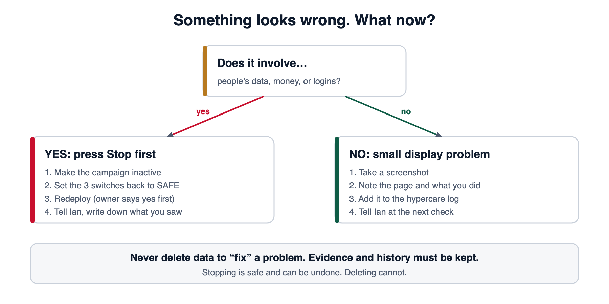

# Hypercare plan and runbooks

*What to do while the pilot is closely watched after real applicants arrive, and exactly what to do when something goes wrong.*

> **Read this first.** If something looks wrong and you are not sure what it is: **do not guess, do not delete anything.** Go to [the Stop button](#2-the-stop-button), then tell the owner. Stopping is safe and can be undone.

**In this document:** [1. What hypercare is](#1-what-hypercare-is) · [2. The Stop button](#2-the-stop-button) · [3. Who does what](#3-who-does-what) · [4. The hypercare log](#4-the-hypercare-log) · [5. Checklists](#5-checklists) · [6. How serious is it?](#6-how-serious-is-it) · [7. Runbooks](#7-runbooks) · [8. Ending hypercare](#8-ending-hypercare) · [9. Handover sign-off](#9-handover-sign-off)

---

## 1. What hypercare is

When a new restaurant opens, the owner stays in the kitchen, tastes every dish, and fixes small things right away. **Hypercare is that.** Right after real people start using SafeCard, we watch it much more closely than usual, answer questions fast, and write down everything we learn.

**Goals**

1. No real applicant is harmed, embarrassed, or left waiting without an answer.
2. Every application is reviewed fairly.
3. Small problems are found while they are still small.
4. We learn what to fix before opening to more people.

**The pilot is deliberately small.** The campaign is limited (the default cap is **50 applications**) so that mistakes stay small. Do not raise the cap during hypercare.

---

## 2. The Stop button

SafeCard has **no single red button on screen**, but it has three switches that behave like one. Turning them all to **SAFE** puts the website back in practice mode: **real applications are refused**, and nothing already stored is touched.



### When to use it

Press it first and ask questions second if you see **any** of these:

- Someone’s private details appear where they should not (a wrong person, a public page, a message).
- A receipt link works for someone who should not have it.
- A password, key or secret has been pasted somewhere public (chat, email, GitHub).
- Money looks wrong (wrong amount shown, wrong account shown).
- The site accepts applications but admins cannot see them (or the reverse).
- A decision was made that cannot be explained.
- You simply feel something is badly wrong. **You do not need to be sure.**

### How to do it (owner or an authorised person)

> **Order matters. Do not skip a step.**

1. **Make the campaign inactive.** In **Supabase → SQL Editor**, first look at the row, then change it. Replace the id with the real campaign id.
   ```sql
   -- A. Look first. You should see exactly ONE row, the right campaign.
   select id, name, is_active from public.pilot_campaigns where id = '<campaign id>';

   -- B. Then stop it.
   update public.pilot_campaigns set is_active = false where id = '<campaign id>';
   ```
2. **Set the three switches to SAFE** in **Vercel → your project → Settings → Environment Variables → Production**:

   | Name | Set to |
   |---|---|
   | `NEXT_PUBLIC_DATA_MODE` | `synthetic` |
   | `LAUNCH_GATES_COMPLETE` | `false` |
   | `ENABLE_OFFICIAL_PAYMENT_HANDOFF` | `false` |

3. **Redeploy** so the new values take effect. In Vercel → **Deployments** → the latest one → **Redeploy**. (Changing a variable does nothing until you redeploy. Only the **owner’s own Vercel account** is used, and the owner says “yes” first.)
4. **Check it worked.** Open the website, press **Apply**. You should see the **practice-mode banner**, and no real payment details. Open `/admin/login` to confirm the site itself is still up.
5. **Tell the owner** (if they did not do it themselves) and **write it in the [log](#4-the-hypercare-log)**: time, what you saw, what you did.
6. **Do not delete anything.** Receipts, audit events, submissions and history are evidence. Keep them all.

### How to undo it (go live again)

Only after the owner confirms the problem is understood and fixed:

1. Set the three switches back to their live values (see [the settings table](03-technical-handover.md#5-settings-and-the-safety-switches)).
2. Set the campaign active again (`is_active = true`).
3. Redeploy and run one careful test with an authorised participant. **Never create fake applicants in production.**

---

## 3. Who does what

Fill this table in before launch and keep a printed copy.

| Job | Who | How to reach them |
|---|---|---|
| **Owner** (decides, deploys, approves going live) | Ian Vince | ____________ |
| **Hand-over recipient / second pair of eyes** | Indy | ____________ |
| **Application reviewers** | ____________ | ____________ |
| **Support / call-backs** | ____________ | ____________ |
| **Philippine Red Cross contact** (benefit questions) | ____________ | members@redcross.org.ph · (+63 2) 8790-2300 loc 184 · Hotline 143 |

**Rule of thumb for escalation:** *If you are unsure, ask. If it touches private data or money, stop first, then ask.*

---

## 4. The hypercare log

Keep **one running log**. A shared document or spreadsheet is fine. It is the memory of the team.

| When | Who | What happened / what I saw | Severity | What I did | Follow-up needed? |
|---|---|---|---|---|---|
| | | | | | |

**Rules for the log**

- **No private data.** Use the application reference (`SC-2026-…`), never a name, number or address.
- **Write it down the moment it happens**, even if it seems small.
- Number the follow-ups so nothing is forgotten.

---

## 5. Checklists

### Each check

- [ ] Open the **public site** on your phone. Does the home page load? Does **Apply** open?
- [ ] Switch language FIL ⇄ EN. Does it still read correctly?
- [ ] Sign in to **admin**. Does the overview load with sensible numbers?
- [ ] **Awaiting review**: is any application still waiting that should already have a decision?
- [ ] Look in **Vercel → Logs** for red errors and in **Supabase → Logs** for repeated failures. You are looking for *unusual*, not *perfect*.
- [ ] Any messages or calls from applicants? Log them.
- [ ] Anything odd? Write it in the log.

### Regular review

- [ ] Count: applications received, approved, rejected, still waiting.
- [ ] Read the **rejection reasons**: are they clear and kind? Are the same ones repeating (meaning the form needs clearer instructions)?
- [ ] List the **questions people asked**. Are they answered on the Help page?
- [ ] Confirm **only the right people** have staff accounts.
- [ ] Confirm the three **safety switches** are still what you expect.
- [ ] Confirm the **campaign cap** (default 50) has not been reached silently.
- [ ] Review the log with the owner.

---

## 6. How serious is it?

| Level | What it looks like | Do this |
|---|---|---|
| **1: Critical** | Private data exposed, secret leaked, money shown wrongly, unexplained decisions | **[Stop button](#2-the-stop-button)** → tell owner now → log |
| **2: Major** | Applicants cannot apply or upload; admins cannot sign in; reviewers cannot open applications | Tell owner now. Stop if it involves data or money. |
| **3: Minor** | Wrong wording, a layout glitch, one slow page, one confusing message | Screenshot (no private data) → log → fix through a normal pull request |
| **4: Idea** | “It would be nicer if…” | Log it for the owner |

---

## 7. Runbooks

Each runbook says **what you see**, **what to do**, and **who to tell**. They are written so you can follow them while stressed.

### R1. An administrator cannot sign in

1. Ask them to check the email, then type the password slowly. Make sure Caps Lock is off.
2. Ask them to try once more. **Do not let them keep trying.**
3. Tell the owner. The owner checks the account under **Supabase → Authentication → Users** and resets it if needed.
4. Log it. If *several* people cannot sign in at once, treat it as Level 2.

### R2. A receipt will not open in the review panel

1. Close the panel and open it again. Reload the page once.
2. Try a different browser.
3. If it still fails, **do not decide** on that application. Leave it waiting.
4. Log the application reference and tell the owner. (A reviewer’s link to a receipt is short-lived, so reopening the panel creates a fresh one.)

### R3. An applicant says they paid but their status has not changed

1. Find them with the **search box** (reference or mobile number).
2. Is the application in your list? If **yes**, review it as normal.
3. If it is **not** in the list, it is not yet “complete” (details submitted **and** proof uploaded). Tell the applicant to open their status page and follow the next step shown.
4. Never approve without a visible proof of payment.

### R4. An applicant was approved but cannot see their card

1. The card appears only when the application is **approved** *and* the payment proof is **verified**. Approving does both, so check the status in the list.
2. Ask the applicant to **sign out and in again** (sessions last 30 minutes).
3. Still missing? Tell the owner with the application reference. Do not try to “re-approve”.

### R5. A decision was made by mistake

1. **Stop deciding.** Do not try to hide or undo it on your own.
2. Write down the application reference, the time, and what you did.
3. Tell the owner immediately. The decision history is permanent and visible by design; the owner chooses the correct, recorded way to fix it.

### R6. A secret, password or key was pasted somewhere public

1. **Stop button** now.
2. Tell the owner. The owner **replaces the exposed value** (a new key or password) in Supabase / Vercel, and redeploys.
3. Do **not** try to delete the message and hope. Assume it was seen.
4. Log it. The owner decides whether anyone else must be told.

### R7. The site is down or very slow

1. Try another device and another network (mobile data).
2. Check the status pages for **Vercel** and **Supabase**.
3. In Vercel → **Deployments**, did a deployment just happen? If the new one is broken, the owner can promote the **previous good deployment** (this is a code rollback only; it never touches data).
4. Log what you saw and when it started and ended.

### R8. A page shows the wrong wording or a typo

1. Screenshot it (no private data), note the page and language (FIL or EN).
2. Log it as Level 3.
3. The fix is a normal pull request (see [the lifecycle](03-technical-handover.md#10-changing-and-releasing-code-the-lifecycle)). Most public wording is in `src/lib/education/content.ts`. **Filipino wording is a draft until the Red Cross approves it**; do not change benefit amounts or promises without the owner.

### R9. Christmas mode looks wrong

1. Note the page, the language (FIL or EN) and the device, and take a screenshot with no private data.
2. Tell the owner. Christmas mode is always on and has no switch, so going back to the original look is a **separate request** that becomes a normal pull request.
3. Details of what it touches: [Christmas mode guide](../christmas-mode.md).

### R10. The campaign has reached its application limit

1. Do not raise the limit yourself. Tell the owner.
2. The owner decides whether to close, extend or open a new campaign (this needs the reviewed pilot process).

### R11. Someone asks you to delete or show their data

1. Do not delete anything and do not read the data aloud.
2. Point them to the **Privacy** page and the **Help** page.
3. Log it and pass it to the owner, who handles privacy requests.

### R12. A message says “urgent: approve this now” or asks for passwords

1. Treat it as a scam until proven otherwise. **No one needs your password.**
2. Do not click links in it. Tell the owner.
3. Never approve under pressure; follow the normal order.

---

## 8. Ending hypercare

When you think hypercare can end, hold a short **exit review** (the owner and Indy). Hypercare ends when **all** of these are true:

- [ ] No Level 1 or Level 2 issue is open.
- [ ] No application is waiting without a decision, and nobody is waiting on an answer.
- [ ] The log has been read through and every follow-up is done, scheduled, or deliberately dropped.
- [ ] The Help page answers the most common questions people asked.
- [ ] Staff accounts match the people who should have them.
- [ ] A backup plan exists, or the owner has written down why not yet.
- [ ] The owner has signed off in writing.

If not all are true, **keep hypercare going** and review again. There is no shame in extending.

---

## 9. Handover sign-off

Use this page to record that the handover happened.

| Check | Done | Initials |
|---|---|---|
| I have read the [README](README.md) and know who owns what | | |
| I can explain, in my own words, what SafeCard does | | |
| I can sign in to the admin area on practice data | | |
| I know where the **Stop button** is and what each step does | | |
| I have the contact table filled in | | |
| I know the **two rules that never bend** (code only to the project repo; live changes only from the owner’s Vercel, after a clear yes) | | |
| I know which Supabase project belongs to our deployment, and which one is not ours | | |
| I have asked every question I had | | |

**Handed over by:** ______________ **Received by:** ______________
